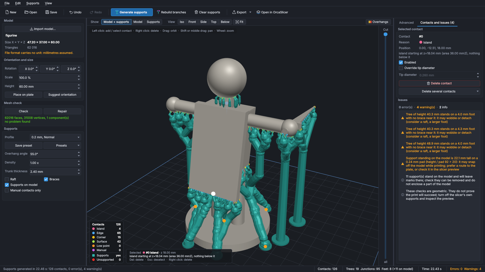

# ArborFDM

**Hybrid tree supports for FDM-printed miniatures.** ArborFDM generates sturdy FDM trunks and branches that touch the model only through thin tips, then exports the model and its supports as a single 3MF (or STL) for your slicer.

*Version française : [voir plus bas](#en-français).*



> [!WARNING]
> **Early version (0.2.0), not validated by systematic print tests.** The engine, GUI, CLI and exports work and are covered by automated tests (`docs/TEST_REPORT.md`), and the first real prints led to profile changes, but tip sizes, densities and feet are still reasoned starting points. Only OrcaSlicer has been tried so far. Read [`docs/LIMITATIONS.md`](docs/LIMITATIONS.md) before printing anything you care about, and please share your results.

ArborFDM is an independent, original implementation. Its feature set was inspired by publicly described features of commercial support tools for miniatures; it does not use, contain or derive from their code, assets or data, and it is not affiliated with or endorsed by any of them.

## Features

- Import STL (ASCII/binary), OBJ, 3MF; real dimensions, scale in mm or %, rotation, drop to plate, suggested orientations with their support cost.
- Mesh diagnosis (holes, non-manifold edges, degenerate faces, flipped normals) and repair on a copy, never silently.
- Layer-by-layer analysis: islands, overhangs (coloured by angle), hanging edges, flat-face corners, low points.
- Contacts placed with a reason for each one (island, low point, corner, edge, surface, manual), avoiding thin details.
- Trees: thin tip, branch, merge, trunk that thickens, wide flared foot; braces, raft, supports resting on the model (option), short supports for low clearances.
- Self-check after generation: unsupported contacts, supports in the void, floating supports, disconnected branches, unstable trunks, collisions with the model.
- Manual editing (left click adds a contact, right click removes it), undo/redo, branch-only rebuild.
- Profiles for 0.2 and 0.4 mm nozzles, Light / Normal / Dense, plus your own saved presets.
- 3MF export (model + supports + raft as separate objects, or one object per layer height for Orca/Bambu) and STL; every file is re-read and validated after writing.
- Scriptable command line.

## Download (Windows)

1. Download `ArborFDM-<version>-windows-x64.zip` from the **Releases** page of this repository (never from elsewhere).
2. Optional but recommended: check its SHA-256 against `SHA256SUMS.txt` from the same release: `certutil -hashfile ArborFDM-<version>-windows-x64.zip SHA256`.
3. Unzip anywhere (for example `Documents\ArborFDM`) and run `ArborFDM.exe`. No Python needed. `arborfdm-cli.exe` in the same folder is the command line.

The executables are **not code-signed**. Windows SmartScreen will show "Windows protected your PC": click *More info*, then *Run anyway*. Some antivirus programs flag PyInstaller-built apps as false positives; see [`docs/PACKAGING.md`](docs/PACKAGING.md#smartscreen-antivirus-et-signature) for what to check and how to report it.

## Install from source (Windows, Linux, macOS)

Requires **Python 3.10.1 to 3.14, 64-bit** (3.12 recommended). Python 3.15+ does not work yet (no `manifold3d` package), Python 3.10.0 has a bug that breaks the Windows build.

```
git clone <repository URL> arborfdm
cd arborfdm
python -m venv .venv
# Windows: .venv\Scripts\activate      Linux/macOS: source .venv/bin/activate
python -m pip install -e ".[gui]"          # add ",dev" for tests and packaging: ".[gui,dev]"
```

- Linux: Qt needs the usual system libraries (Debian/Ubuntu: `sudo apt install libegl1 libgl1 libxkbcommon0 libxkbcommon-x11-0 libdbus-1-3 libfontconfig1`).
- macOS: not tested yet; the dependencies publish macOS packages, reports welcome.
- Keep the editable install (`-e`): the built-in profiles are read from the `profiles/` folder of the source tree.

Run:

```
python -m arbor.app.main         # GUI   (or scripts\run_dev.bat / scripts/run_dev.sh)
python -m arbor --help           # CLI
```

## Command line

```
python -m arbor profiles
python -m arbor check examples/figurine.stl
python -m arbor generate examples/figurine.stl -o out/figurine.3mf --profile nozzle_04_normal --json out/report.json
python -m arbor generate model.stl -o out.3mf --profile nozzle_02_dense --set tip_diameter=0.3 --repair --auto-orient
```

Compare several profiles or user presets on the same model before printing (same load / repair / orientation steps as `generate`, nothing is exported):

```
python -m arbor compare examples/figurine.stl --profile nozzle_02_light --profile nozzle_02_normal --profile nozzle_02_dense
python -m arbor compare model.stl --profile nozzle_04_normal --preset "My figurines" --set tip_diameter=0.4 --md cmp.md --csv cmp.csv --json cmp.json
```

The table gives, per configuration: contacts (and how many supports stand on the model), trees, support volume and PLA mass (1.24 g/cm3), total contact area on the model (a proxy of the marks), highest tree, largest slenderness, errors and warnings by code, time. The "best" lines only name the lowest value per criterion (fewest marks, least material, fewest issues); they do not say which configuration prints better. `--preset` takes a user preset name; `--set` applies to every configuration. Exit code 1 if a configuration has verification errors.

With the Windows release, use `arborfdm-cli.exe` instead of `python -m arbor`. Exit codes: 0 success, 1 file written but verification errors, 2 input error, 130 interrupted. Full reference: [`docs/PACKAGING.md`](docs/PACKAGING.md#cli).

## In your slicer

The supports are in the file: **turn off the slicer's automatic supports**, and set the **same nozzle** in the slicer as in the ArborFDM profile, otherwise thin tips and branches disappear. In PrusaSlicer, OrcaSlicer and Bambu Studio, answer **Yes** to the "multi-part object" question so the model and its supports stay together. Details: [`docs/SLICERS.md`](docs/SLICERS.md).

## Documentation

Documentation is currently in French (the interface is in English).

| File | Content |
|---|---|
| [`docs/USER_GUIDE.md`](docs/USER_GUIDE.md) | User guide of the GUI |
| [`docs/LIMITATIONS.md`](docs/LIMITATIONS.md) | Known limitations, what is not validated |
| [`docs/ROADMAP.md`](docs/ROADMAP.md) | Roadmap: what is planned, with value and cost estimates |
| [`docs/SLICERS.md`](docs/SLICERS.md) | Slicer compatibility |
| [`docs/PHYSICAL_TESTS.md`](docs/PHYSICAL_TESTS.md) | Print test protocol (help wanted) |
| [`docs/ALGORITHM.md`](docs/ALGORITHM.md) | How the engine works |
| [`docs/ARCHITECTURE.md`](docs/ARCHITECTURE.md) | Architecture and design choices |
| [`docs/TEST_REPORT.md`](docs/TEST_REPORT.md), [`docs/QA_REVIEW.md`](docs/QA_REVIEW.md), [`docs/BENCHMARKS.md`](docs/BENCHMARKS.md) | Tests actually run, QA review, measured performance |
| [`docs/PACKAGING.md`](docs/PACKAGING.md) | Windows build, release, SmartScreen / antivirus |
| [`docs/LICENSES.md`](docs/LICENSES.md) | Dependency licenses and obligations |
| [`CHANGELOG.md`](CHANGELOG.md) | Version history |

## Contributing

Bug reports, print results (with photos) and pull requests are welcome, in English or French. See [`CONTRIBUTING.md`](CONTRIBUTING.md). **Never attach or commit models you are not allowed to share** (paid or Patreon miniatures). Tests: `QT_QPA_PLATFORM=offscreen python -m pytest -q`.

## License

ArborFDM is free software released under the GNU General Public License v3.0 or later ([`LICENSE`](LICENSE)): you may use, study, modify and share it; distributed modified versions must stay under the GPL with their source code. The Windows release bundles third-party libraries under their own licenses, including Qt / PySide6 under the LGPL v3, dynamically linked: see [`THIRD_PARTY_NOTICES.md`](THIRD_PARTY_NOTICES.md) and [`docs/LICENSES.md`](docs/LICENSES.md).

The example models in `examples/` and the screenshots in `docs/screenshots/` are generated by the project's own scripts (`scripts/make_examples.py`, `tests/models/synthetic.py`, `scripts/screenshot.py`).

## Contact

Questions and bugs: GitHub issues. Security problems: see [`SECURITY.md`](SECURITY.md).

---

## En français

**ArborFDM génère des supports arborescents « hybrides » pour imprimer des figurines en FDM** : des troncs et branches robustes qui ne touchent le modèle que par une pointe fine, exportés avec le modèle dans un 3MF (ou un STL) prêt pour le slicer.

> [!WARNING]
> **Version précoce (0.2.0), non validée par des essais d'impression systématiques.** Les profils (pointes, densités, pieds) sont des points de départ raisonnés ; seul OrcaSlicer a été essayé. Lisez [`docs/LIMITATIONS.md`](docs/LIMITATIONS.md) et partagez vos résultats.

- **Windows** : téléchargez `ArborFDM-<version>-windows-x64.zip` dans les *Releases* du dépôt, vérifiez le SHA-256 (`certutil -hashfile <zip> SHA256`), dézippez, lancez `ArborFDM.exe`. L'exécutable n'est pas signé : SmartScreen affiche un avertissement (*Informations complémentaires*, puis *Exécuter quand même*) et certains antivirus peuvent signaler un faux positif (voir `docs/PACKAGING.md`).
- **Depuis les sources** : Python 3.10.1 à 3.14 en 64 bits (3.12 conseillé), puis `python -m pip install -e ".[gui]"` dans un venv ; lancement avec `python -m arbor.app.main` (interface) ou `python -m arbor --help` (CLI).
- **Dans le slicer** : désactivez les supports automatiques, réglez la même buse que le profil ArborFDM, répondez **Oui** à la question « objet multi-pièces ».
- La documentation détaillée (`docs/`) est en français ; l'interface est en anglais.
- Contributions et retours d'impression bienvenus en français ou en anglais : [`CONTRIBUTING.md`](CONTRIBUTING.md). Ne joignez jamais de modèles payants ou sous licence.

Licence : GPL-3.0 ou ultérieure (GNU GPL v3+). ArborFDM est une implémentation originale et indépendante, sans lien avec les éditeurs d'autres outils de supports.
